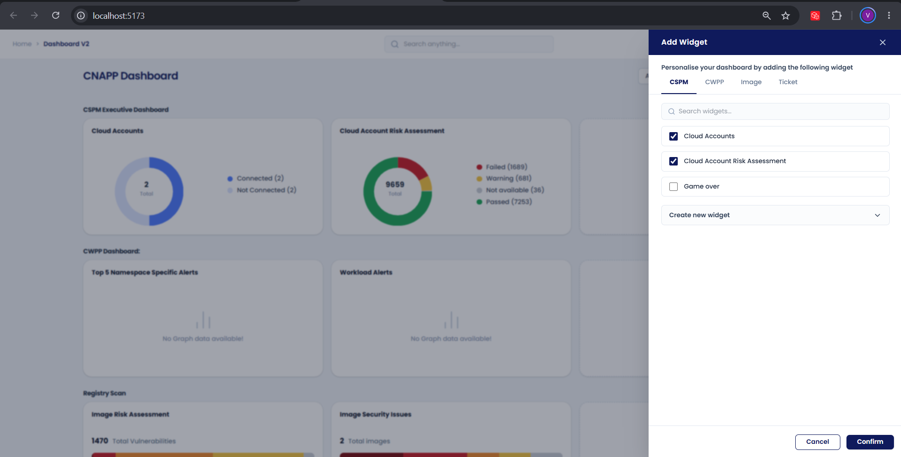
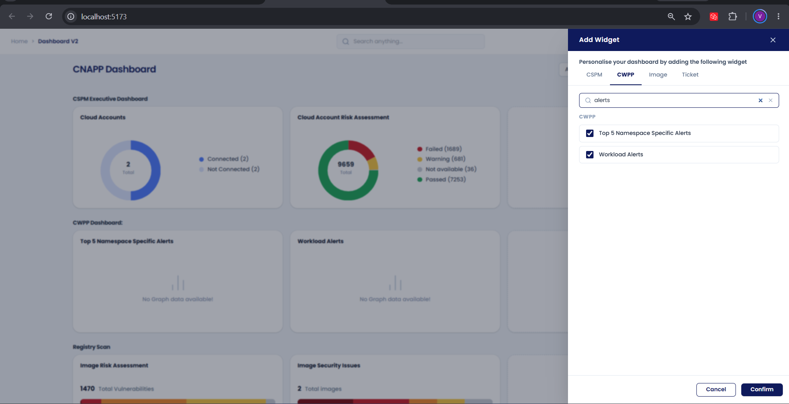

# CNAPP Dashboard

CNAPP Dashboard is a category-based cloud security posture and workload dashboard driven by dynamic JSON configuration. It provides visualization widgets across security domains (such as CSPM, CWPP, and Registry Scan), allowing security teams to inspect compliance and risk metrics, add custom notes, manage widget visibility via an interactive drawer, and search widgets across categories with full state persistence.

**Live demo:** [cnapp-dashboard-user-interface.vercel.app](https://cnapp-dashboard-user-interface.vercel.app/)

## Screenshots

- **Dashboard Overview**: 
- **Add Widget Drawer**: 
- **Drawer Search**: 

## Features

- [x] JSON-driven categories, each configured with multiple widgets.
- [x] Add widgets via drawer checklist or custom creation form, and remove via card close button or unchecking.
- [x] Text widgets and chart widgets (donut, stacked bar, empty state).
- [x] Real-time search inside the drawer across all category tabs, and top navigation bar filtering visible dashboard widgets.
- [x] Full state persistence in localStorage with schema validation and safe fallback.
- [x] Accessible modal drawer with focus trap, ArrowLeft/ArrowRight keyboard navigation for tabs, and explicit ARIA labels.
- [x] Interactive polish including simulated refresh spinner, time-range selector, notification popover, and chart tooltips.

## Tech Stack

React 19, Vite, TypeScript, Redux Toolkit, Tailwind CSS v4, Recharts, Vitest + Testing Library, lucide-react.

## Getting Started

### Prerequisites
- Node.js 18+

### Scripts
- `npm install`: Install project dependencies.
- `npm run dev`: Start local development server at [http://localhost:5173](http://localhost:5173).
- `npm run test`: Run unit and integration tests via Vitest.
- `npm run build`: Type-check with TypeScript and build production bundle via Vite.
- `npm run lint`: Run code linter using oxlint.

## JSON Schema

The root dashboard contains `categories[]` (each with `id`, `name`, `tabLabel`, and `widgets[]`) and `widgets[]` (discriminated union sharing `id`, `name`, and `isActive`).
Supported widget types are `donut`, `stackedBar`, `empty`, and `text`.

Example donut widget:
```json
{
  "id": "cloud-accounts",
  "name": "Cloud Accounts",
  "isActive": true,
  "type": "donut",
  "total": 2,
  "segments": [
    { "label": "Connected", "value": 2, "color": "blue" },
    { "label": "Not Connected", "value": 2, "color": "lightBlue" }
  ]
}
```

ColorKey values: `blue`, `lightBlue`, `red`, `darkRed`, `orange`, `amber`, `green`, `grey`.
Widget removal sets `isActive: false` instead of deleting the entry so users can re-enable it at any time from the drawer checklist without losing its definition.

## Architecture

Many small files are intentional: one responsibility per component, slice and helper, each covered by tests.

### Source Structure (`src/`)
- `app/`: Store setup, typed Redux hooks, and localStorage persistence subscriber.
- `components/`: Shared base UI components.
- `data/`: Default dashboard seed configuration (`dashboard.json`).
- `docs/`: Captured documentation screenshots.
- `features/`: Domain features (`dashboard`, `search`, `ui`, `widget-drawer`).
- `test/`: Vitest test suites across slices, components, and utilities.
- `types/`: TypeScript domain models and discriminated widget unions.
- `utils/`: LocalStorage handling, schema validator, and search helpers.

### Redux Slices
- `dashboard` (`dashboardSlice.ts`): Owns canonical categories, widgets, additions (`addWidget`), removals (`removeWidget`), active toggling (`toggleWidget`), and committing drawer changes (`applyDrawerChanges`).
- `drawer` (`drawerSlice.ts`): Owns drawer visibility (`isOpen`), active tab (`activeTab`), draft toggles (`draftActive`), draft creations (`draftNewWidgets`), and actions `toggleDraftWidget` and `addDraftWidget` (drawer search is local component state).
- `search` (`searchSlice.ts`): Owns top-bar search query string.
- `ui` (`uiSlice.ts`): Owns only `timeRange` and `isRefreshing` state.

### Draft-Then-Confirm Flow
1. Opening the drawer resets draft state; draft selection is lazy so selectors fall back to `widget.isActive` when unedited.
2. Checking or unchecking items dispatches `toggleDraftWidget` to update `draftActive`, and form additions queue into `draftNewWidgets`.
3. Clicking Confirm dispatches `applyDrawerChanges` with draft selections and closes the drawer; clicking Cancel or pressing Escape closes and discards drafts.

The shared helper `filterWidgetsByQuery` powers both top-bar and drawer search. Drawer tabs support `ArrowLeft` and `ArrowRight` keyboard navigation.

## Persistence

- Stored in localStorage under key `cnapp.dashboard.v1`.
- Only the canonical `dashboard` slice is saved; invalid or corrupted data safely falls back to default `dashboard.json`.
- To reset state to default, run in browser console: `localStorage.removeItem('cnapp.dashboard.v1'); location.reload()`.

## Known Limitations

- The refresh button simulates network latency and spinning animation without a real remote API.
- The time-range selector is UI-only and does not filter underlying mock data.
- Clicking "Home" scrolls to the top of the page; no multi-page routing is implemented.
- Medium, Low, and Unknown values in registry widgets are mock data because they were illegible in the reference screenshot.
- The Ticket category remains hidden until at least one active widget is added to it.

## Project Decisions

- **Redux Toolkit**: Centralized predictable state management with Immer immutability and TypeScript safety.
- **`isActive` Flag**: Preserves widget configuration metadata and allows simple restoration from the drawer.
- **Drawer Draft State**: Prevents live dashboard churn until user explicitly confirms changes.

## Future Work

- Enable custom chart widget authoring (defining dynamic data rows, chart types like donut or stacked bar, and custom color palette assignments).
