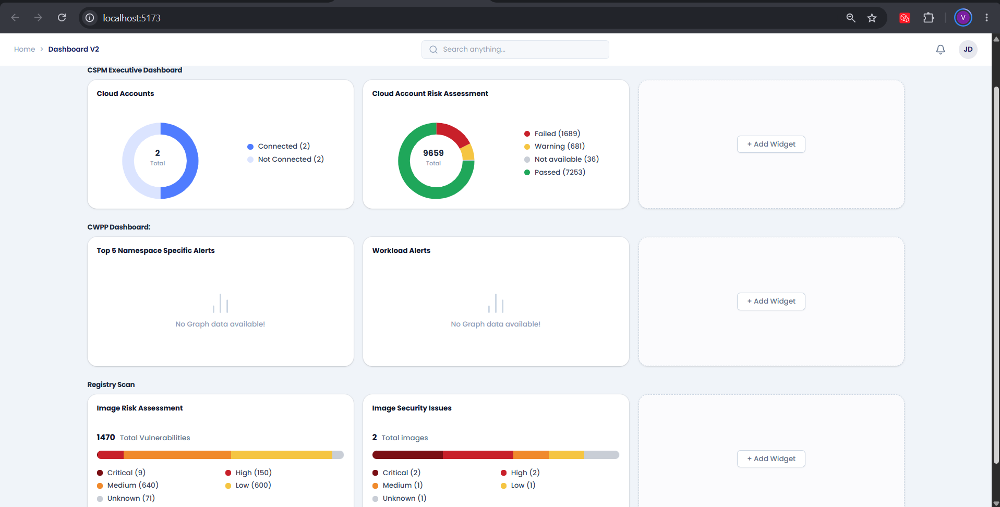

# CNAPP Dashboard

CNAPP Dashboard is a category-based cloud security posture and workload dashboard driven by dynamic JSON configuration. It provides visualization widgets across security domains (such as CSPM, CWPP, and Registry Scan), allowing security teams to inspect compliance and risk metrics, add custom notes, manage widget visibility via an interactive drawer, and search widgets across categories with full state persistence.

## Screenshots

> Note: The reference screenshot images are located at `src/docs/screenshots/` in the repository structure. If relative paths from the project root are required at `docs/screenshots/`, note that `docs/screenshots/dashboard.png`, `docs/screenshots/drawer.png`, and `docs/screenshots/drawer-search.png` do not exist at the repository root; their actual files reside at `src/docs/screenshots/`. Relative links below point to both paths for accessibility:

- **Dashboard Overview**:
  
  *Category sections displaying donut charts, stacked horizontal bars, and an empty state card.*

- **Add Widget Drawer**:
  
  *Slide-over drawer showing tabbed category navigation, widget visibility checklist, and custom widget creation form.*

- **Drawer Search**:
  
  *Real-time cross-tab widget search within the add widget drawer.*

## Features

- [x] **JSON-driven categories, each with multiple widgets**: Categories (`CSPM`, `CWPP`, `Image`, `Ticket`) and their respective widgets are dynamically configured from JSON (`src/data/dashboard.json`).
- [x] **Add and remove widgets**:
  - Add widgets via category checklist checkboxes or create custom text widgets with a name and content text field.
  - Remove widgets instantly using the card header close button (`×`) or by unchecking them in the drawer checklist.
- [x] **Text widgets and chart widgets**:
  - **Donut Chart**: Built with Recharts `PieChart`, displaying centered total count and color-coded metric legends.
  - **Stacked Bar**: Proportionate multi-segment horizontal bar breakdown with total indicators and custom tooltip inspection.
  - **Empty State**: Placeholder representation for widgets with no graph data available.
  - **Text Widget**: Custom user-defined notes or alert descriptions rendered cleanly in a card container.
- [x] **Search**:
  - Search inside the drawer filtering available widgets across all category tabs simultaneously.
  - Top navigation search bar filtering visible dashboard widgets across active categories in real time.
- [x] **Persistence in localStorage**:
  - Automatically persists the dashboard state to localStorage under the key `cnapp.dashboard.v1`.
  - Validates retrieved data and safely falls back to default JSON data if invalid or corrupt.
- [x] **Accessibility**:
  - Focus trap (`useFocusTrap`) constraining Tab navigation within the drawer when open.
  - Keyboard navigation for tabs (Arrow Left, Arrow Right, Home, End).
  - Explicit ARIA labels (`aria-label`, `aria-selected`, `role="tab"`, `role="tabpanel"`, `role="dialog"`).
- [x] **Interaction Polish**:
  - Simulated data refresh with spinning indicator.
  - Time-range selector dropdown with active state indicator.
  - Notification popover with dismissable backdrop/escape click handler (`useDismissable`).
  - Interactive chart tooltips for granular inspection of bar and donut segments.

## Tech Stack

- **React 19**: Modern UI component library using functional components and hooks.
- **Vite**: Ultra-fast build tool and development server.
- **TypeScript**: End-to-end static typing across store slices, actions, and UI widgets.
- **Redux Toolkit**: Predictable state management with slices, memoized selectors, and store subscriber persistence.
- **Tailwind CSS v4**: Utility-first CSS styling.
- **Recharts**: Composable charting library for donut charts and responsive containers.
- **Vitest & Testing Library**: Unit and integration test suite with jsdom environment.
- **lucide-react**: Clean, consistent icon set.

## Getting Started

### Prerequisites

- Node.js 18.0.0 or higher
- npm 9.0.0 or higher

### Installation & Scripts

Run the exact commands configured in `package.json`:

1. **Install dependencies**:
   ```bash
   npm install
   ```

2. **Start development server**:
   ```bash
   npm run dev
   ```
   Open the local URL displayed in the terminal: [http://localhost:5173](http://localhost:5173).

3. **Run unit & integration tests**:
   ```bash
   npm run test
   ```

4. **Build for production**:
   ```bash
   npm run build
   ```

5. **Lint source code**:
   ```bash
   npm run lint
   ```

## JSON Schema

The dashboard structure is defined by `Dashboard`, containing an array of `categories[]`, each housing an array of `widgets[]`.

### Types

- **`categories[]`**: Represents dashboard categories (`id`, `name`, `tabLabel`, `widgets[]`).
- **`widgets[]`**: Discriminated union of widget definitions sharing `id`, `name`, and `isActive: boolean`.
- **`ColorKey`**: Supported chart color palette tokens (`blue`, `lightBlue`, `red`, `darkRed`, `orange`, `amber`, `green`, `grey`).

### Widget Types & Examples

#### 1. Donut Widget (`donut`)
Displays circular segment proportions with a central total value:
```json
{
  "id": "cloud-accounts",
  "name": "Cloud Accounts",
  "isActive": true,
  "type": "donut",
  "total": 2,
  "segments": [
    { "label": "Connected", "value": 2, "color": "blue" },
    { "label": "Not Connected", "value": 2, "color": "lightBlue" }
  ]
}
```

#### 2. Stacked Bar Widget (`stackedBar`)
Displays proportionate horizontal bars:
```json
{
  "id": "image-security-issues",
  "name": "Image Security Issues",
  "isActive": true,
  "type": "stackedBar",
  "total": 2,
  "totalLabel": "Total images",
  "segments": [
    { "label": "Critical", "value": 2, "color": "darkRed" },
    { "label": "High", "value": 2, "color": "red" }
  ]
}
```

#### 3. Empty State Widget (`empty`)
Placeholder for widgets without data:
```json
{
  "id": "workload-alerts",
  "name": "Workload Alerts",
  "isActive": true,
  "type": "empty",
  "message": "No Graph data available!"
}
```

#### 4. Text Widget (`text`)
Displays custom user-authored notes or text alerts:
```json
{
  "id": "custom-security-note",
  "name": "Audit Checklist",
  "isActive": true,
  "type": "text",
  "text": "Quarterly security posture review scheduled for Q4."
}
```

### Why Removal Sets `isActive: false`

Instead of deleting widget records from the collection, removal sets `isActive: false`. This design choice:
1. Retains widget definitions and metadata so users can re-enable existing widgets at any time from the drawer checklist without losing historical configurations or chart definitions.
2. Preserves stable identifiers across sessions.
3. Separates widget existence from visibility presentation.

## Architecture

Many small files are intentional: one responsibility per component, slice and helper, each covered by tests.

### Directory Structure (`src/`)

```
src/
├── App.tsx
├── index.css
├── main.tsx
├── app/
│   ├── hooks.ts             # Typed useSelector and useDispatch hooks
│   ├── persistStore.ts      # Redux store subscriber for localStorage synchronization
│   └── store.ts             # Redux store configuration and rootReducer
├── components/              # Shared component directory placeholder
├── data/
│   └── dashboard.json       # Initial seed data for categories and widgets
├── docs/
│   └── screenshots/         # Captured screenshot artifacts
│       ├── dashboard.png
│       ├── drawer-search.png
│       └── drawer.png
├── features/
│   ├── dashboard/
│   │   ├── dashboardSlice.ts       # Manages categories, active widgets, additions, and removals
│   │   ├── selectors.ts            # Memoized selectors for active and visible categories/widgets
│   │   ├── components/
│   │   │   ├── AddWidgetPlaceholder.tsx # Dashed "+ Add Widget" card opening drawer
│   │   │   ├── CategorySection.tsx      # Renders category header and widget grid
│   │   │   ├── DashboardHeader.tsx      # Dashboard title and action controls
│   │   │   ├── DashboardPage.tsx        # Main dashboard container layout
│   │   │   ├── NotificationBell.tsx     # Notification button and popover dropdown
│   │   │   ├── RefreshButton.tsx        # Simulated refresh trigger with spin animation
│   │   │   ├── TimeRangeDropdown.tsx    # Filter time range dropdown
│   │   │   ├── TopBar.tsx               # Global top bar with search and navigation
│   │   │   ├── WidgetCard.tsx           # Reusable widget frame with remove button
│   │   │   └── widgets/
│   │   │       ├── DonutWidget.tsx      # Recharts donut visualization
│   │   │       ├── EmptyWidget.tsx      # Empty graph placeholder
│   │   │       ├── StackedBarWidget.tsx # Stacked bar visualization
│   │   │       ├── TextWidget.tsx       # Text note content renderer
│   │   │       └── WidgetRenderer.tsx   # Polymorphic widget variant dispatcher
│   │   └── utils/
│   │       ├── categoryVisibility.ts    # Logic determining when categories render
│   │       ├── colorMap.ts              # Maps ColorKey to CSS color values
│   │       └── segments.ts              # Segment calculations and percentage distribution
│   ├── search/
│   │   └── searchSlice.ts          # Owns global dashboard search query state
│   ├── ui/
│   │   ├── timeRanges.ts           # Time range options constant definitions
│   │   ├── uiSlice.ts              # Owns UI popover states, selected time range, and refresh state
│   │   └── hooks/
│   │       ├── useDismissable.ts   # Click outside and Escape key handler
│   │       └── useSimulatedRefresh.ts # Timer hook for animated refresh state
│   └── widget-drawer/
│       ├── confirmDrawer.ts        # Helper dispatching staged changes to dashboard slice
│       ├── drawerSlice.ts          # Owns drawer open state, active tab, drafts, and drawer search
│       ├── selectors.ts            # Selectors computing filtered widgets and active states
│       ├── components/
│       │   ├── AddWidgetDrawer.tsx # Slide-over modal drawer with focus trap
│       │   ├── CreateWidgetForm.tsx# Form for authoring new text widgets
│       │   ├── DrawerFooter.tsx    # Cancel and Confirm action buttons
│       │   ├── DrawerHeader.tsx    # Drawer title and close button
│       │   ├── DrawerSearch.tsx    # Real-time search input inside drawer
│       │   ├── DrawerTabs.tsx      # Accessible keyboard-navigable category tabs
│       │   └── WidgetChecklist.tsx # Toggleable widget checklist
│       └── hooks/
│           └── useFocusTrap.ts     # Traps focus within modal dialogs
├── test/                           # Unit and integration test suite
├── types/
│   └── dashboard.types.ts          # Core domain TypeScript models and interfaces
└── utils/
    ├── dashboardStorage.ts         # localStorage loader and writer
    ├── loadDashboard.ts            # Initial seed loader
    ├── searchWidgets.ts            # Shared case-insensitive substring search helper
    └── validateDashboard.ts        # Runtime schema validation for persisted JSON
```

### Redux Slices

- **`dashboard` (`dashboardSlice.ts`)**: Owns canonical categories and widgets data, widget toggling (`toggleWidgetActive`), widget addition (`addWidget`), removal (`removeWidget`), and batch confirmation (`applyDrawerChanges`).
- **`drawer` (`drawerSlice.ts`)**: Owns drawer presentation (`isOpen`), currently active category tab (`activeCategoryId`), search query within the drawer (`searchQuery`), draft toggle selections (`draftActive`), and pending created widgets (`draftNewWidgets`).
- **`search` (`searchSlice.ts`)**: Owns the global dashboard search query entered in the top navigation bar.
- **`ui` (`uiSlice.ts`)**: Owns transient UI state including the selected time range, notifications popover visibility, and simulated refresh spinner status.

### Draft-Then-Confirm Drawer Flow

When the user opens the drawer:
1. `openDrawer` initializes `draftActive` mapping from current widget active states.
2. Toggling checkboxes in the drawer updates local draft state (`toggleDraftActive`) without mutating the live dashboard.
3. Adding a new widget through the form appends it to `draftNewWidgets` and marks its draft state as active.
4. Clicking **Confirm** executes `confirmDrawer()`, which dispatches `applyDrawerChanges` to commit draft selections and new widgets to the canonical `dashboard` slice, then closes the drawer.
5. Clicking **Cancel** or pressing Escape dispatches `closeDrawer()`, discarding uncommitted draft changes.

### Shared Search Helper

Both top-bar dashboard search and drawer widget search utilize the shared helper function `filterWidgetsByQuery` located at `src/utils/searchWidgets.ts`. It performs case-insensitive substring matching against item `name` properties and preserves array references when the query string is blank to avoid superfluous selector recalculations.

## Persistence

- **Storage Key**: `cnapp.dashboard.v1`
- **Scope**: Only the canonical `dashboard` slice (categories and widgets) is persisted to `localStorage`. Ephemeral states such as open drawers, transient search queries, and popover toggles are excluded.
- **Validation & Fallback**: On application launch, `loadSavedDashboard()` parses stored data through `validateDashboard()`. If schema validation fails, or if data is missing or corrupted, it safely logs a warning and falls back to default seed data from `dashboard.json`.
- **How to Reset**:
  Open the browser developer console and run:
  ```javascript
  localStorage.removeItem('cnapp.dashboard.v1');
  location.reload();
  ```

## Known Limitations

- **Simulated Refresh**: The refresh button triggers a simulated animation and spinner; there is no live remote backend API.
- **Time-Range Selector**: The 2-day / 7-day / 30-day selector is UI-only and does not filter underlying mock chart data.
- **Home Navigation**: Clicking "Home" in the breadcrumbs scrolls the window to the top; there is no multi-page router.
- **Mock Registry Data**: Medium, Low, and Unknown vulnerability counts in the registry widgets use mock values because they were not legibly readable in the original reference screenshot.
- **Ticket Category Visibility**: The `Ticket` category is hidden from the dashboard view until it has at least one active widget (it starts empty in `dashboard.json`).

## Project Decisions

- **Why Redux Toolkit**: Provides predictable, centralized state management with TypeScript inference, built-in Immer support for immutable updates, and clean separation between domain dashboard data and ephemeral UI state.
- **Why the `isActive` Flag**: Retaining inactive widgets prevents permanent data loss, allows easy re-activation from the drawer checklist, and avoids complex restore mechanics.
- **Why Drawer Draft State**: Isolating checkbox edits and form additions in draft state ensures that closing or canceling the drawer leaves the active dashboard unchanged until the user explicitly clicks Confirm.

## Future Work

- **Custom Chart Widget Creation**: Expand the widget creation form to support user-configured charts (specifying chart type: donut or stacked bar, customizable segment labels, numerical values, and palette color picks).
